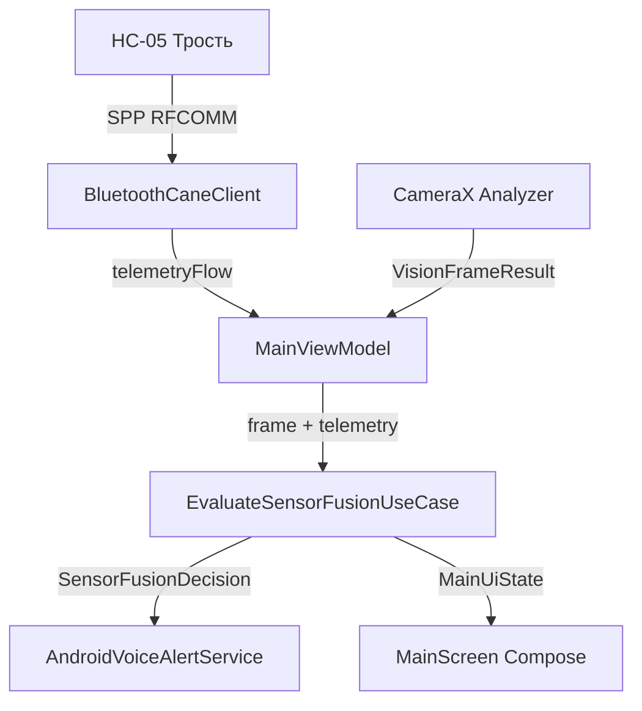

# План модернизации умной трости Argus (Pre-Midterm Upgrade)

**Ветка:** `feature/pre-midterm-upgrade`  
**Репозиторий:** [https://github.com/adiletbtrv/argus](https://github.com/adiletbtrv/argus)  
**Роль:** Системный архитектор  
**Статус:** Архитектурные решения приняты; реализовано ядро Bluetooth SPP + Sensor Fusion + Unit тесты; пошаговый план подготовлен для выполнения следующей моделью.

---

## 1. Архитектурные решения и разрешение противоречий

### 1.1. Единая шкала дистанций и площадей (разрешение конфликта порогов)
**Противоречие:** В исходной кодовой базе `SpatialClassifier.kt` использовались пороги `NEAR > 0.35`, `MEDIUM 0.10..0.35`, `FAR < 0.10`. Команда предложила новые пороги площади рамки: игнорировать `< 0.06`, от `0.12` — *"Впереди {объект}"*, от `0.28` — *"Вплотную, {объект}!"*.

**Архитектурное решение:** 
Объединить шкалы в единую модель без дублирования констант.
- **Шумовой порог (`areaRatio < 0.06`):** Отсекается на этапе классификации/фильтрации. Объекты с площадью менее 6% площади кадра считаются фоновым шумом или объектами на безопасном удалении (> 3-4 метров), не влияющими на непосредственную траекторию шага незрячего человека.
- **`DistanceCategory.FAR` (`0.06 <= areaRatio < 0.12`):** Объекты регистрируются системой (для контроля свободных коридоров слева/справа), но голосовой синтезатор молчит, чтобы не перегружать пользователя («тихий горизонт»).
- **`DistanceCategory.MEDIUM` (`0.12 <= areaRatio < 0.28`):** Препятствие входит в динамический коридор движения. Фраза: *"Впереди {объект}"* (или при препятствии по центру — коридорная навигация *"Прямо {объект}, обойдите {слева/справа}"*).
- **`DistanceCategory.NEAR` (`areaRatio >= 0.28`):** Препятствие в непосредственной близости. Фраза: *"Вплотную, {объект}!"* с флагом `urgent = true`.

### 1.2. Односторонняя связь Bluetooth (Трость → Телефон) и кнопка «Тест/Калибровка»
**Противоречие:** Команда предлагала кнопку «Тест/Калибровка» на экране смартфона, что могло навести на мысль об отправке управляющих команд на HC-05.
**Архитектурное решение:**
- Канал связи строго **односторонний (Simplex, Cane -> Phone)**. На Arduino пин RX (D10) физически не используется, в прошивке вызывается `btSerial.stopListening()`.
- В Android-приложении в коде `BluetoothCaneClient` полностью отсутствует вызов `outputStream.write()`.
- Кнопка **«Тест/Калибровка»** на экране телефона:
  1. Если Bluetooth-соединение активно — выполняет мягкий реконнект сокета RFCOMM.
  2. Если подключение отсутствует (демонстрация жюри без включенной трости) — запускает локальный демо-прогон (Jury Demo Mode): эмулирует последовательность телеметрии (`DIST:60,DIR:CENTER` -> `DIST:28,DIR:LEFT` -> `DIST:45,DIR:RIGHT`), демонстрируя реакцию интерфейса и голосовые оповещения.

### 1.3. Фильтрация классов COCO vs HazardClassifier
**Архитектурное решение:**
- Фильтрация по 10 значимым классам COCO применяется **исключительно** к детектору объектов (`MediaPipe / Bounding-box ObjectDetector`):
  `person, chair, dining table, bench, backpack, suitcase, potted plant, car, bicycle, dog`.
- **Класс "door" исключён** из фильтра детектора COCO (в датасете COCO отсутствует класс `door`).
- Обнаружение дверей (`DoorAhead`), лестниц (`StairsAhead`) и стен (`WallProximity`) остаётся в ведении `HazardClassifier.kt` через существующий `ImageLabeler` и эвристики — этот пайплайн не модифицируется.

### 1.4. Русификация TextToSpeech и статусных панелей
**Архитектурное решение:**
- В `AndroidVoiceAlertService` инициализация переводится на `Locale("ru", "RU")` с проверкой `setLanguage()` на `LANG_MISSING_DATA` / `LANG_NOT_SUPPORTED` и фолбэком на текущую локаль устройства.
- Все фразы синтезатора переводятся на русский язык.
- Экранные карточки статуса: «ДИСТАНЦИЯ ТРОСТИ: XX СМ», «КУРС: ПРЯМО/ВЛЕВО/ВПРАВО».

### 1.5. Подтверждение кулдауна 4 секунды
**Архитектурное подтверждение:**
В `AndroidVoiceAlertService.kt` уже реализована константа `SAME_TEXT_COOLDOWN_MS = 4000L` и проверка `(now - lastSpokenTime < SAME_TEXT_COOLDOWN_MS)`. Повторная реализация не требуется.

### 1.6. Закрытие Issue #11 («Калибровка MPU6050 по кнопке вместо автозапуска»)
- **Номер Issue:** `#11`
- **Формулировка закрытия:** 
  > Закрыто архитектурным решением: автокалибровка смещения гироскопа/акселерометра MPU6050 при старте прошивки (усреднение первых 20 измерений угла крена) в сочетании с аппаратной защитой `Wire.setWireTimeout(3000, true)`. 
  > Физическая кнопка/тумблер калибровки исключена из конструкции, так как для незрячего пользователя поиск отдельной кнопки при каждом включении создает риск случайного сбоя калибровки в движении. Программное усреднение 20 отсчетов за 100 мс при включении питания полностью решает проблему дрейфа нуля без усложнения аппаратной части.

---

## 2. Прошивка Arduino Nano (`firmware/argus_cane/argus_cane.ino`)

### 2.1. Неблокирующий вибро-импульс на `millis()`
Вместо блокирующего `delay()` внедряется двухфазный конечный автомат (FSM).

**Формула и параметры:**
- Диапазон расстояния: от `5 см` до `50 см`.
- Длительность вибро-импульса: `VIBRO_PULSE_DURATION_MS = 40L` (короткий четкий тактильный щелчок).
- Длительность паузы между импульсами (чем ближе, тем чаще):
  $$\text{pauseMs} = \text{map}(\text{constrain}(dist, 5, 50), 5, 50, 40, 400)$$
  * При $dist = 5\text{ см}$: пауза 40 мс (частое жужжание).
  * При $dist = 50\text{ см}$: пауза 400 мс (редкие тактильные тики).

**Код автомата состояний:**
```cpp
const unsigned long VIBRO_PULSE_MS = 40;
bool vibroActive = false;
unsigned long vibroTimerMs = 0;

void updateVibrationFSM(long distCm, unsigned long now) {
  if (distCm <= 0 || distCm > 50) {
    if (vibroActive) {
      analogWrite(PIN_VIBRO, 0);
      vibroActive = false;
    }
    return;
  }

  unsigned long pauseMs = map(constrain(distCm, 5, 50), 5, 50, 40, 400);

  if (vibroActive) {
    if (now - vibroTimerMs >= VIBRO_PULSE_MS) {
      analogWrite(PIN_VIBRO, 0);
      vibroActive = false;
      vibroTimerMs = now;
    }
  } else {
    if (now - vibroTimerMs >= pauseMs) {
      analogWrite(PIN_VIBRO, VIBRO_INTENSITY);
      vibroActive = true;
      vibroTimerMs = now;
    }
  }
}
```

### 2.2. Защита шины I2C и автокалибровка MPU6050
В `setup()`:
```cpp
Wire.begin();
Wire.setWireTimeout(3000, true); // сброс I2C при зависании SDA/SCL > 3 мс

// Автокалибровка первых 20 отсчетов крена
float rollSum = 0;
for (int i = 0; i < 20; i++) {
  mpu.update();
  rollSum += mpu.getAngleX();
  delay(5);
}
float rollOffset = rollSum / 20.0;
```

### 2.3. Постоянная телеметрия каждые 150-200 мс
Телеметрия передаётся циклически независимо от наличия препятствия:
```cpp
const unsigned long TELEMETRY_INTERVAL_MS = 180;
unsigned long lastTelemetryMs = 0;

if (now - lastTelemetryMs >= TELEMETRY_INTERVAL_MS) {
  lastTelemetryMs = now;
  sendTelemetry(currentDist, currentDir);
}
```

### 2.4. Детектор подключения зарядки на A1
```cpp
const int PIN_CHARGING = A1;
bool lastChargingState = false;

// В loop(): детектирование восходящего фронта (0 -> 1)
bool currentChargingState = (analogRead(PIN_CHARGING) > 512);
if (currentChargingState && !lastChargingState) {
  triggerDoubleBeepVibro(); // неблокирующий двойной импульс
}
lastChargingState = currentChargingState;
```

---

## 3. Архитектура Android-приложения

### 3.1. Структура классов и поток данных


1. **`domain/model/CaneTelemetry.kt`**:
   - `CaneDirection`: `CENTER`, `LEFT`, `RIGHT`.
   - `CaneTelemetry`: `distanceCm`, `direction`, `timestamp`.
   - Парсер строки: `DIST:<cm>,DIR:<dir>`.
   - Проверка критической дистанции: `isCriticalDistance = distanceCm in 1 until 35`.
2. **`domain/bluetooth/CaneBluetoothClient.kt`**:
   - Абстракция подключения (`telemetryFlow`, `connectionStatus`, `connect()`, `disconnect()`, `triggerDemoOrReconnect()`).
   - Исключает любые методы записи (строго односторонний контракт).
3. **`data/bluetooth/BluetoothCaneClient.kt`**:
   - Реализация Bluetooth Classic SPP (`UUID: 00001101-0000-1000-8000-00805F9B34FB`).
   - Чтение в фоновом корутинном цикле на `Dispatchers.IO`.
   - Обработка runtime-разрешений `BLUETOOTH_CONNECT` (Android 12+).
   - Поддержка Jury Demo Mode при отсутствии соединения.
4. **`domain/usecase/EvaluateSensorFusionUseCase.kt`**:
   - Независимый юзкейс (Clean Architecture / SRP), объединяющий данные ультразвукового сонара и гироскопа трости с оптическим распознаванием препятствий.

---

## 4. Реализованная часть (Архитектурное ядро)

В рамках данной задачи уже полностью реализованы и протестированы самые рискованные компоненты:
1. `android/app/src/main/java/com/project/argus/domain/model/CaneTelemetry.kt` — модель телеметрии и регулярный парсер.
2. `android/app/src/main/java/com/project/argus/domain/bluetooth/CaneBluetoothClient.kt` — интерфейс клиента связи.
3. `android/app/src/main/java/com/project/argus/data/bluetooth/BluetoothCaneClient.kt` — SPP клиент с гарантией односторонней передачи данных.
4. `android/app/src/main/java/com/project/argus/domain/usecase/EvaluateSensorFusionUseCase.kt` — логика сенсор-фьюжна:
   - Критическая дистанция сонара (< 35 см) -> мгновенное прерывание (`urgent = true`).
   - Совпадение направления наклона трости и стороны препятствия по камере -> *"Осторожно, слева/справа преграда!"*.
   - Анализ свободных коридоров при препятствии по центру -> *"Прямо {объект}, обойдите слева/справа"*.
   - Единая шкала порогов 0.06 / 0.12 / 0.28.
5. Unit-тесты:
   - `CaneTelemetryTest.kt` (все сценарии парсинга и порогов).
   - `EvaluateSensorFusionUseCaseTest.kt` (все ветви сенсор-фьюжна и коридоров).
   - Тесты успешно скомпилированы и пройдены (`BUILD SUCCESSFUL in 21s`).

---

## 5. Пошаговый план работ для завершения модернизации

Следующая модель с большим токен-бюджетом должна последовательно выполнить следующие шаги:

### Шаг 1: Доработка `SpatialClassifier.kt` и фильтра классов COCO
- **Файл:** `android/app/src/main/java/com/project/argus/data/vision/SpatialClassifier.kt`
  - Обновить `classifyDistance` под новые пороги:
    - `>= 0.28f` -> `DistanceCategory.NEAR`
    - `>= 0.12f` -> `DistanceCategory.MEDIUM`
    - иначе -> `DistanceCategory.FAR`
- **Файл:** `android/app/src/main/java/com/project/argus/data/vision/VisionResultProcessor.kt`
  - Внедрить фильтрацию COCO-классов для Bounding-Box детектора:
    `val ALLOWED_COCO_CLASSES = setOf("person", "chair", "dining table", "bench", "backpack", "suitcase", "potted plant", "car", "bicycle", "dog")`
  - Игнорировать объекты с `fraction < 0.06f`.

### Шаг 2: Русификация TextToSpeech (`AndroidVoiceAlertService.kt`)
- **Файл:** `android/app/src/main/java/com/project/argus/data/tts/AndroidVoiceAlertService.kt`
  - В методе `onInit`:
    ```kotlin
    val ruLocale = Locale("ru", "RU")
    val result = engine.setLanguage(ruLocale)
    if (result == TextToSpeech.LANG_MISSING_DATA || result == TextToSpeech.LANG_NOT_SUPPORTED) {
        Log.w(TAG, "Russian TTS not supported, falling back to default locale")
        engine.setLanguage(Locale.getDefault())
    }
    ```
- **Файл:** `android/app/src/main/java/com/project/argus/domain/usecase/AlertStrategy.kt`
  - Перевести строки стратегий на русский:
    - `StairsAlertStrategy`: *"Осторожно, впереди лестница!"*
    - `WallProximityAlertStrategy`: *"Внимание, стена прямо по курсу!"*
    - `DoorAheadAlertStrategy`: *"Впереди дверной проём"*
    - `ArmrestAlertStrategy`: *"Подлокотник {слева/справа/впереди}"*

### Шаг 3: Интеграция `BluetoothCaneClient` и `EvaluateSensorFusionUseCase` в `MainViewModel`
- **Файл:** `android/app/src/main/java/com/project/argus/ArgusApplication.kt`
  - Инициализировать `bluetoothCaneClient = BluetoothCaneClient(this, applicationScope)`
  - Инициализировать `evaluateSensorFusionUseCase = EvaluateSensorFusionUseCase()`
- **Файл:** `android/app/src/main/java/com/project/argus/ui/main/MainUiState.kt`
  - Добавить поля:
    `val caneDistanceCm: Int? = null`,
    `val caneDirection: CaneDirection = CaneDirection.CENTER`,
    `val bluetoothStatus: BluetoothConnectionStatus = BluetoothConnectionStatus.DISCONNECTED`
- **Файл:** `android/app/src/main/java/com/project/argus/ui/main/MainViewModel.kt`
  - Подписаться на `bluetoothCaneClient.telemetryFlow`:
    - При обновлении телеметрии обновлять `MainUiState`.
    - Если `telemetry.isCriticalDistance` (< 35 см) — немедленно вызывать `speechOutput.speak(decision.spokenText, urgent = true)`.
  - В `onFrameAnalyzed`:
    - Вызывать `evaluateSensorFusionUseCase(result, latestCaneTelemetry)` и озвучивать решение.
  - Добавить метод `onTestCalibrationClicked()` -> `bluetoothCaneClient.triggerDemoOrReconnect()`.

### Шаг 4: Обновление UI (`CameraPreviewView.kt` / `MainScreen.kt`)
- Добавить контрастные информационные плашки для слабовидящих/жюри:
  - Панель: **«ДИСТАНЦИЯ ТРОСТИ: XX СМ»** (красный фон при < 35 см, зеленый при > 50 см).
  - Панель: **«КУРС: ПРЯМО / ВЛЕВО / ВПРАВО»**.
  - Кнопка: **«Тест / Калибровка»** с обработчиком `viewModel.onTestCalibrationClicked()`.

### Шаг 5: Обновление прошивки `firmware/argus_cane/argus_cane.ino`
- Внедрить неблокирующий FSM виброотклика на `millis()` с формулой `map(constrain(dist, 5, 50), 5, 50, 40, 400)`.
- Убрать `delay(20)` из `loop()`.
- Добавить `Wire.setWireTimeout(3000, true)` и автокалибровку первых 20 отсчетов крена в `setup()`.
- Организовать периодическую отправку телеметрии каждые 180 мс.
- Подключить обработку детектора зарядки на пине `A1`.

### Шаг 6: Финальная верификация
- Запустить `./gradlew testDebugUnitTest` в директории `android/`.
- Проверить симуляцию Wokwi/Tinkercad для прошивки.
