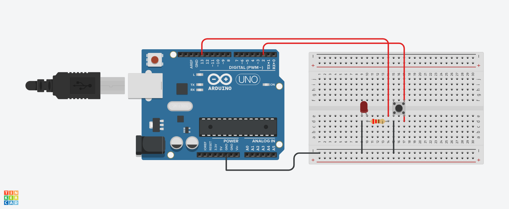

# P0000: Кнопка и Светодиод (Button + LED)

## 📌 Описание
Базовая схема управления светодиодом с помощью кнопки.

##  Схема подключения


##  Исходный код (C++)
```cpp
void setup() {
  pinMode(2, INPUT_PULLUP); 
  pinMode(13, OUTPUT);       
}

void loop() {
  if (digitalRead(2) == LOW) {
    digitalWrite(13, HIGH);  
  } else {
    digitalWrite(13, LOW);   
  }
}
