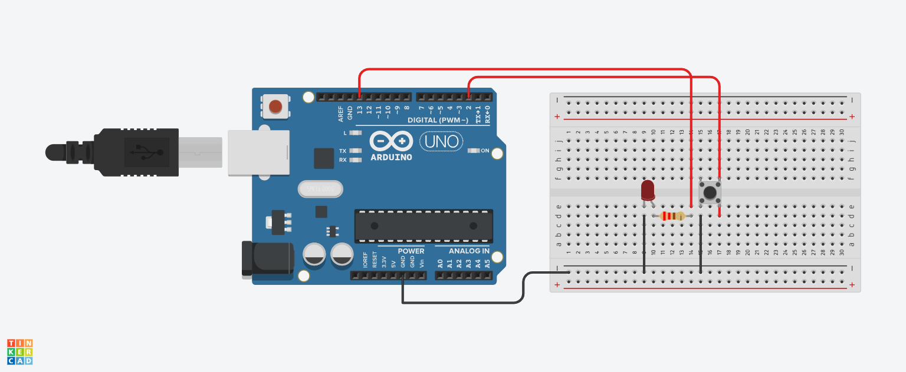

# P0000: Кнопка и Светодиод (Button + LED)

## Описание

Базовый аппаратный прототип проверки цифрового ввода-вывода на микроконтроллере в симуляторе Tinkercad: считывание нажатия тактовой кнопки (`INPUT_PULLUP`) и управление светодиодным индикатором (`OUTPUT`).

---

## Схема подключения



```text
Arduino Uno
   │
   ├─── D2 (INPUT_PULLUP) ◄── [ Кнопка (Pushbutton) ] ──── GND
   │
   └─── D13 (OUTPUT) ───────► [ Резистор / Светодиод (LED) ] ──── GND
```

---

### Таблица соединений:

| Пин Arduino Uno | Компонент / Вывод | Назначение |
| :--- | :--- | :--- |
| `D2` | Кнопка (Pushbutton) | Цифровой вход с внутренней подтяжкой (`INPUT_PULLUP`) |
| `GND` | Кнопка (второй контакт), LED (катод) | Общая земля схемы |
| `D13` | Светодиод (LED, анод через резистор) | Цифровой выход индикации (`OUTPUT`) |

---

## Исходный код (C++)

```cpp
void setup() {
  pinMode(2, INPUT_PULLUP);
  pinMode(13, OUTPUT);
}

void loop() {
  if (digitalRead(2) == LOW) {
    digitalWrite(13, HIGH);
  } else {
    digitalWrite(13, LOW);
  }
}
```
