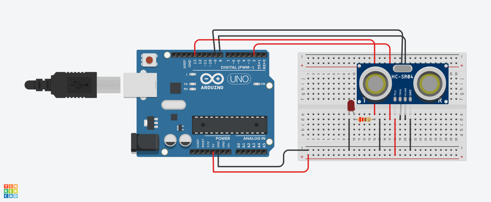

# P0001: Ультразвуковой датчик + Светодиод (HC-SR04 + LED)

## Описание

Аппаратный прототип проверки ультразвукового дальномера **HC-SR04** и световой индикации в симуляторе Tinkercad:
- **Измерение расстояния ультразвуком:** контроллер формирует запускающий импульс на `TRIG` и измеряет длительность отражённого сигнала на `ECHO` для расчёта дистанции до препятствия в сантиметрах.
- **Световая индикация по порогу:** если объект находится ближе тестового порога `20 см` (при корректном замере `distance > 0`), включается светодиодный индикатор на `D13`.
- **Следующий шаг после `P0000`:** переход от ручного нажатия кнопки к автоматическому считыванию расстояния с датчика.

---

## Схема подключения



```text
Arduino Uno
   │
   ├─── 5V ─────────────────── [ HC-SR04: VCC ]
   │
   ├─── GND ────────────────── [ HC-SR04: GND ] / [ LED: Катод ]
   │
   ├─── D9 (TRIG_PIN, OUTPUT) ─► [ HC-SR04: TRIG ]
   │
   ├─── D8 (ECHO_PIN, INPUT) ◄── [ HC-SR04: ECHO ]
   │
   └─── D13 (LED_PIN, OUTPUT) ─► [ Резистор / LED: Анод ]
```
---

### Таблица соединений:
| Пин Arduino Uno | Компонент / Вывод | Назначение |
|:---|:---|:---|
| `5V` | HC-SR04 (`VCC`) | Питание ультразвукового датчика |
| `GND` | HC-SR04 (`GND`), Светодиод (`LED`, катод) | Общая земля схемы |
| `D8` (`ECHO_PIN`) | HC-SR04 (`ECHO`) | Цифровой вход для замера длительности эхо-импульса (`pulseIn`) |
| `D9` (`TRIG_PIN`) | HC-SR04 (`TRIG`) | Цифровой выход запуска импульса (`10 мкс`) |
| `D13` (`LED_PIN`) | Светодиод (`LED`, анод через токоограничивающий резистор) | Цифровой выход индикации препятствия ближе `20 см` |

---

## Исходный код (C++)

```cpp
const int TRIG_PIN = 9;
const int ECHO_PIN = 8;
const int LED_PIN = 13;

void setup() {
  pinMode(TRIG_PIN, OUTPUT);
  pinMode(ECHO_PIN, INPUT);
  pinMode(LED_PIN, OUTPUT);
}

void loop() {
  digitalWrite(TRIG_PIN, LOW);
  delayMicroseconds(2);
  digitalWrite(TRIG_PIN, HIGH);
  delayMicroseconds(10);
  digitalWrite(TRIG_PIN, LOW);

  long duration = pulseIn(ECHO_PIN, HIGH);
  int distance = duration * 0.034 / 2;

  if (distance > 0 && distance < 20) {
    digitalWrite(LED_PIN, HIGH);
  } else {
    digitalWrite(LED_PIN, LOW);
  }
  delay(50);
}
