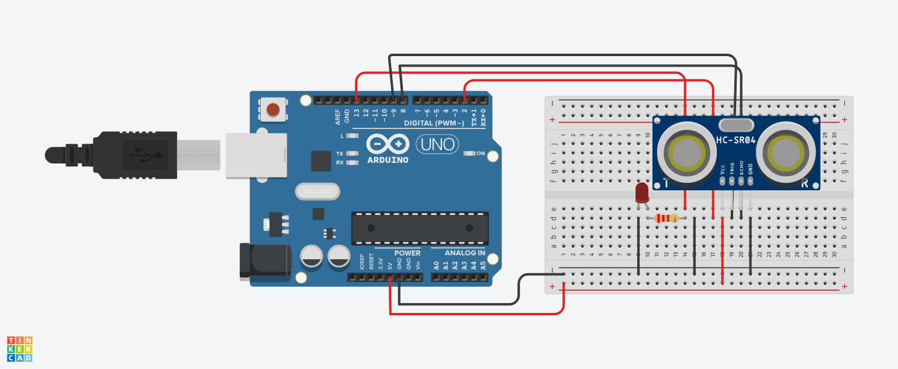

# P0001: Ультразвуковой датчик + Светодиод (HC-SR04 + LED)

## Описание
Прототип считывания расстояния с ультразвукового датчика HC-SR04. Если препятствие ближе 20 см, включается светодиодный индикатор.

---

## Схема подключения


---

## Исходный код (C++)

```cpp
const int TRIG_PIN = 9;
const int ECHO_PIN = 8;
const int LED_PIN = 13;

void setup() {
  pinMode(TRIG_PIN, OUTPUT);
  pinMode(ECHO_PIN, INPUT);
  pinMode(LED_PIN, OUTPUT);
}

void loop() {
  digitalWrite(TRIG_PIN, LOW);
  delayMicroseconds(2);
  digitalWrite(TRIG_PIN, HIGH);
  delayMicroseconds(10);
  digitalWrite(TRIG_PIN, LOW);

  long duration = pulseIn(ECHO_PIN, HIGH);
  int distance = duration * 0.034 / 2;

  if (distance > 0 && distance < 20) {
    digitalWrite(LED_PIN, HIGH);
  } else {
    digitalWrite(LED_PIN, LOW);
  }
  delay(50);
}
```
