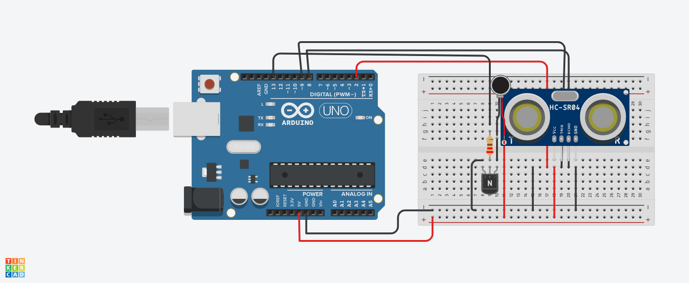

# P0002: Ультразвуковой датчик + Вибропривод через NPN транзистор

## Описание
Силовой контур управления вибромотором через NPN транзистор. При обнаружении препятствия ближе 20 см вибрирует.

> **Примечание по пинам:** В симуляции для упрощения подключено к пину 13. В реальной прошивке трости (`firmware/argus_cane/argus_cane.ino`) вибромотор подключен к пину D9 с аппаратным ШИМ, что позволяет регулировать силу вибрации.

---

## Схема подключения



```text
Arduino Uno
   │
   ├─── 5V ─────────────────── [ HC-SR04: VCC ] / [ Вибромотор (через транзистор) ]
   │
   ├─── GND ────────────────── [ HC-SR04: GND ] / [ Эмиттер NPN-транзистора ]
   │
   ├─── D9 (TRIG_PIN, OUTPUT) ─► [ HC-SR04: TRIG ]
   │
   ├─── D8 (ECHO_PIN, INPUT) ◄── [ HC-SR04: ECHO ]
   │
   └─── D13 (MOTOR_PIN, OUTPUT) ► [ База NPN-транзистора (через резистор) ]
```

---

### Таблица соединений:
| Пин Arduino Uno | Компонент / Вывод | Назначение |
|:---|:---|:---|
| `5V` | HC-SR04 (`VCC`), силовая линия мотора | Питание датчика и цепи вибропривода |
| `GND` | HC-SR04 (`GND`), эмиттер NPN-транзистора | Общая земля схемы |
| `D8` (`ECHO_PIN`) | HC-SR04 (`ECHO`) | Приём эхо-импульса |
| `D9` (`TRIG_PIN`) | HC-SR04 (`TRIG`) | Запуск импульса дальномера |
| `D13` (`MOTOR_PIN`) | База NPN-транзистора (через резистор) | Управление ключом вибромотора (в симуляции D13, в прошивке — D9 с ШИМ) |

---

## Исходный код (C++)

```cpp
const int TRIG_PIN = 9;
const int ECHO_PIN = 8;
const int MOTOR_PIN = 13;

void setup() {
  pinMode(TRIG_PIN, OUTPUT);
  pinMode(ECHO_PIN, INPUT);
  pinMode(MOTOR_PIN, OUTPUT);
}

void loop() {
  digitalWrite(TRIG_PIN, LOW);
  delayMicroseconds(2);
  digitalWrite(TRIG_PIN, HIGH);
  delayMicroseconds(10);
  digitalWrite(TRIG_PIN, LOW);

  long duration = pulseIn(ECHO_PIN, HIGH);
  int distance = duration * 0.034 / 2; 

  if (distance < 20) {
    digitalWrite(MOTOR_PIN, HIGH); 
  } else {
    digitalWrite(MOTOR_PIN, LOW);
  }
  delay(100);
}
```
