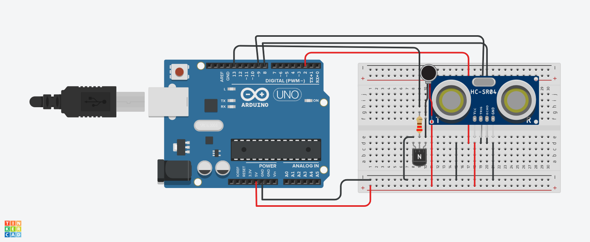

# P0002: Ультразвуковой датчик + Вибропривод через NPN-транзистор

## 📌 Описание
Силовой контур управления вибромотором через NPN-транзистор. При обнаружении препятствия ближе 20 см активируется тактильный отклик (вибрация).

---

## 📷 Схема подключения


---

## 💻 Исходный код (C++)

```cpp
const int TRIG_PIN = 9;
const int ECHO_PIN = 8;
const int LED_PIN = 13;

void setup() {
  pinMode(TRIG_PIN, OUTPUT);
  pinMode(ECHO_PIN, INPUT);
  pinMode(LED_PIN, OUTPUT);
}

void loop() {
  digitalWrite(TRIG_PIN, LOW);
  delayMicroseconds(2);
  digitalWrite(TRIG_PIN, HIGH);
  delayMicroseconds(10);
  digitalWrite(TRIG_PIN, LOW);

  long duration = pulseIn(ECHO_PIN, HIGH);
  int distance = duration * 0.034 / 2; // Перевод микросекунд в см

  if (distance < 20) {
    digitalWrite(LED_PIN, HIGH); // Ближе 20 см — горит LED
  } else {
    digitalWrite(LED_PIN, LOW);
  }
  delay(100);
}
