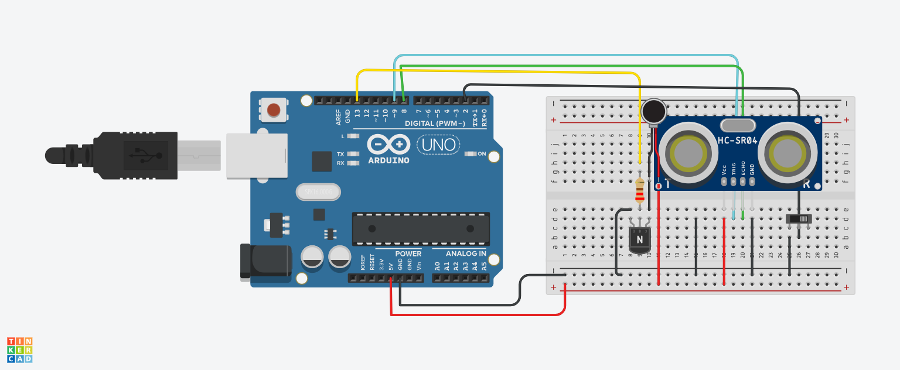

# P0003: Ультразвуковой датчик + Вибропривод + Выключатель (Slide Switch)

## Описание

Макет трости с физическим переключателем питания/режима (**Slide Switch**). Замер расстояния и виброотклик срабатывают только когда тумблер включён (`LOW` на `D2`) и препятствие находится ближе 20 см.

> **Примечание по пинам:** В симуляции для упрощения вибромотор подключен к пину 13, а переключатель — к пину 2. В финальной прошивке (`firmware/argus_cane/argus_cane.ino`) вибромотор вынесен на пин D9 с ШИМ, а системные входы распределены по актуальной схеме (`docs/pinout.md`).

---

## Схема подключения



```text
Arduino Uno
   │
   ├─── 5V ───────────────────── [ HC-SR04: VCC ] / [ Вибромотор (через транзистор) ]
   │
   ├─── GND ──────────────────── [ HC-SR04: GND ] / [ Эмиттер транзистора ] / [ Slide Switch ]
   │
   ├─── D2 (SWITCH_PIN, PULLUP) ◄ [ Slide Switch (переключатель режима) ]
   │
   ├─── D9 (TRIG_PIN, OUTPUT) ──► [ HC-SR04: TRIG ]
   │
   ├─── D8 (ECHO_PIN, INPUT) ◄─── [ HC-SR04: ECHO ]
   │
   └─── D13 (MOTOR_PIN, OUTPUT) ─► [ База NPN-транзистора (через резистор) ]
```

---

### Таблица соединений:

| Пин Arduino Uno | Компонент / Вывод | Назначение |
| :--- | :--- | :--- |
| `5V` | HC-SR04 (`VCC`), силовая линия мотора | Питание датчика и цепи вибропривода |
| `GND` | HC-SR04 (`GND`), эмиттер транзистора, общий контакт тумблера | Общая земля схемы |
| `D2` (`SWITCH_PIN`) | Slide Switch | Переключатель активации (`INPUT_PULLUP`) |
| `D8` (`ECHO_PIN`) | HC-SR04 (`ECHO`) | Приём эхо-импульса |
| `D9` (`TRIG_PIN`) | HC-SR04 (`TRIG`) | Запуск импульса дальномера |
| `D13` (`MOTOR_PIN`) | База NPN-транзистора (через резистор) | Управление ключом вибромотора (в симуляции D13, в прошивке — D9 с ШИМ) |

---

## Исходный код (C++)

```cpp
const int TRIG_PIN = 9;
const int ECHO_PIN = 8;
const int MOTOR_PIN = 13;
const int SWITCH_PIN = 2; 

void setup() {
  pinMode(TRIG_PIN, OUTPUT);
  pinMode(ECHO_PIN, INPUT);
  pinMode(MOTOR_PIN, OUTPUT);
  pinMode(SWITCH_PIN, INPUT_PULLUP); 
}

void loop() {
  if (digitalRead(SWITCH_PIN) == LOW) {
    digitalWrite(TRIG_PIN, LOW);
    delayMicroseconds(2);
    digitalWrite(TRIG_PIN, HIGH);
    delayMicroseconds(10);
    digitalWrite(TRIG_PIN, LOW);

    long duration = pulseIn(ECHO_PIN, HIGH);
    int distance = duration * 0.034 / 2;

    if (distance < 20) {
      digitalWrite(MOTOR_PIN, HIGH); 
    } else {
      digitalWrite(MOTOR_PIN, LOW);
    }
  } else {
    digitalWrite(MOTOR_PIN, LOW);
  }
  
  delay(100);
}
```
