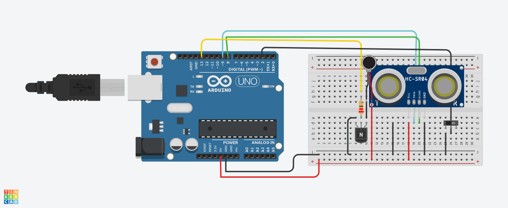

# P0003: Ультразвуковой датчик + Вибропривод + Выключатель (Slide Switch)

## Описание
Макет трости с тумблером питания/активации. Вибрация срабатывает только при включенном тумблере и наличии препятствия ближе 20 см.

> **Примечание по пинам:** В схеме прототипа мотор подключен к пину 13, а в рабочей прошивке используется пин D9 (PWM).

---

## Схема подключения


---

## Исходный код (C++)

```cpp
const int TRIG_PIN = 9;
const int ECHO_PIN = 8;
const int MOTOR_PIN = 13;
const int SWITCH_PIN = 2; 

void setup() {
  pinMode(TRIG_PIN, OUTPUT);
  pinMode(ECHO_PIN, INPUT);
  pinMode(MOTOR_PIN, OUTPUT);
  pinMode(SWITCH_PIN, INPUT_PULLUP); 
}

void loop() {
  if (digitalRead(SWITCH_PIN) == LOW) {
    digitalWrite(TRIG_PIN, LOW);
    delayMicroseconds(2);
    digitalWrite(TRIG_PIN, HIGH);
    delayMicroseconds(10);
    digitalWrite(TRIG_PIN, LOW);

    long duration = pulseIn(ECHO_PIN, HIGH);
    int distance = duration * 0.034 / 2;

    if (distance < 20) {
      digitalWrite(MOTOR_PIN, HIGH); 
    } else {
      digitalWrite(MOTOR_PIN, LOW);
    }
  } else {
    digitalWrite(MOTOR_PIN, LOW);
  }
  
  delay(100);
}
```
