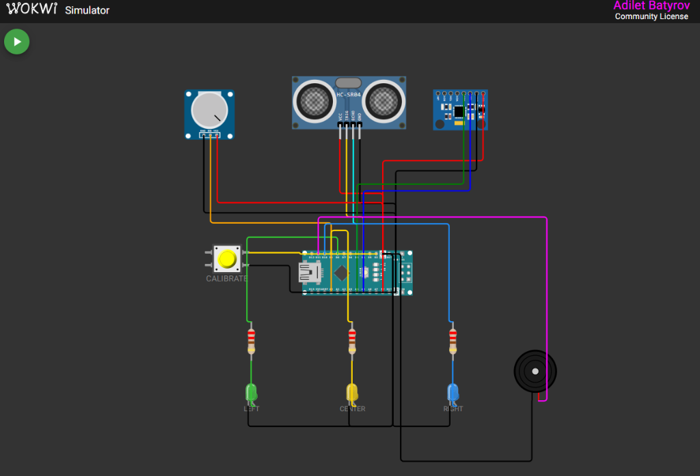

# P0004: Интерактивный Wokwi-стенд трости Argus (Nano + HC-SR04 + Имитация крена + 3x LED + Buzzer)

## Описание

Комплексный интерактивный прототип трости Argus в симуляторе Wokwi, объединяющий подсистемы замера дистанции, тактильного отклика и классификации направления движения:
- **Замер расстояния:** ультразвуковой датчик HC-SR04 с подачей сигнала тревоги на пьезодинамик (buzzer) при препятствии ближе 50 см (имитация вибромотора из P0002);
- **Имитация датчика крена (MPU6050):** аналоговый потенциометр на пине A0 преобразует угол поворота ручки в диапазон крена от -45° до +45°;
- **Определение курса:** используется оригинальный алгоритм классификации направления (`direction_logic.h` / `direction_logic.cpp`) с гистерезисом (пороги 25°/17°) и фильтрацией дребезга (250 мс);
- **Визуальная индикация:** 3 светодиода (зеленый — влево, желтый — прямо, синий — вправо);
- **Кнопка калибровки:** подтянута к D2 (`INPUT_PULLUP`), зажигает встроенный светодиод D13 при нажатии (задел под issue #11);
- **Телеметрия:** непрерывная трансляция состояния `TILT`, `DIR` и `DIST` в Serial Monitor (115200 бод).

---

## Схема подключения



---

## Отличия от реальной платы

| Реальное железо | Замена в Wokwi | Почему |
|:---|:---|:---|
| MPU6050 (гироскоп/акселерометр) | Потенциометр на A0 | Проще плавно управлять углом крена вручную; модуль MPU6050 выведен на схему как визуальный референс |
| Вибромотор (PWM D9) | Пьезодинамик (D11) | Звуковой сигнал наглядно подтверждает срабатывание тактильного отклика |
| Дешифратор 74HC138 (D2/D3/D4) | 3 светодиода (D8/D9/D10) | В Wokwi нет модели 74HC138, прямое подключение светодиодов нагляднее |
| Bluetooth HC-05 (TX D11) | Serial Monitor | Телеметрия `TILT/DIR/DIST` выводится прямо в консоль Wokwi |

---

## Таблица пинов стенда

| Пин Nano | Компонент | Назначение |
|:---|:---|:---|
| D2 | Кнопка (INPUT_PULLUP) | Зарезервирована под калибровку (issue #11) |
| D4 | HC-SR04 TRIG | Запуск ультразвукового импульса |
| D5 | HC-SR04 ECHO | Прием отраженного эхо-импульса |
| D8 | LED (зеленый) | Индикация поворота влево (LEFT) |
| D9 | LED (желтый) | Индикация движения прямо (CENTER) |
| D10 | LED (синий) | Индикация поворота вправо (RIGHT) |
| D11 | Buzzer | Звуковой сигнал тревоги при дистанции < 50 см |
| D13 | Встроенный LED | Индикация нажатия на кнопку D2 |
| A0 | Потенциометр | Имитация угла крена трости (-45°..+45°) |
| A4 (SDA) | MPU6050 | Подключен к I2C шине (референс) |
| A5 (SCL) | MPU6050 | Подключен к I2C шине (референс) |

---

## Исходный код (C++)

Основной код стенда расположен в файле [`wokwi.ino`](wokwi.ino) и использует модуль [`direction_logic`](direction_logic.h):

```cpp
#include "direction_logic.h"

const int BUTTON_PIN = 2;
const int BUILTIN_LED = 13;
const int TRIG_PIN = 4;
const int ECHO_PIN = 5;
const int TILT_POT_PIN = A0;

const int LED_LEFT = 8;
const int LED_CENTER = 9;
const int LED_RIGHT = 10;
const int BUZZER_PIN = 11;

DirectionClassifier classifier;
// ... (полный код см. в wokwi.ino)
```

---

## Как запустить

### В VS Code (расширение Wokwi)
1. Установите расширение [Wokwi Simulator](https://marketplace.visualstudio.com/items?itemName=Wokwi.wokwi-vscode).
2. Скомпилированная прошивка уже входит в репозиторий в каталоге `build/` (`wokwi.ino.hex` и `wokwi.ino.elf`).
3. Откройте файл `diagram.json` в VS Code.
4. Нажмите `Ctrl+Shift+P` → **Wokwi: Start Simulator** (или зеленую кнопку запуска в редакторе схемы).

### В браузере (Wokwi Web)
1. Откройте [wokwi.com](https://wokwi.com) и выберите проект Arduino Nano.
2. Скопируйте содержимое `diagram.json` во вкладку схемы.
3. Добавьте файлы `wokwi.ino`, `direction_logic.h` и `direction_logic.cpp` во вкладки проекта.
4. Нажмите Play.

### Пересборка скетча (при изменении исходного кода)
```bash
arduino-cli compile --fqbn arduino:avr:nano --output-dir build .
```

---

## Сценарий тестирования

1. **Старт:** в Serial Monitor появится сообщение `=== ARGUS CANE SIMULATOR STARTED ===`.
2. **Крен:** вращайте ручку потенциометра (слева вверху). При крене более +25° (или менее -25°) с удержанием свыше 250 мс зажжется зеленый (LEFT) или синий (RIGHT) светодиод. При возврате к центру ниже порога 17° загорится желтый светодиод (CENTER).
3. **Препятствие:** нажмите на ультразвуковой датчик HC-SR04 и измените ползунок расстояния. При значении менее 50 см пьезодинамик издает звуковой сигнал 1 кГц.
4. **Кнопка:** при зажатии кнопки CALIBRATE загорается встроенный светодиод платы Nano (D13).
5. **Телеметрия:** каждые 150 мс в Serial Monitor выводятся актуальные показания: `TILT:<roll>,DIR:<direction>,DIST:<cm> cm`.

---

## Файлы прототипа

| Файл | Описание |
|:---|:---|
| `P0004.png` | Скриншот схемы подключения прототипа |
| `wokwi.ino` | Скетч симулятора для Arduino Nano |
| `diagram.json` | Схема компонентов и соединений Wokwi |
| `direction_logic.h` | Заголовок алгоритма классификации направления |
| `direction_logic.cpp` | Реализация фильтра крена, гистерезиса и задержек |
| `wokwi.toml` | Конфигурационный файл для запуска Wokwi в VS Code |
| `build/` | Предварительно собранные бинарники (`wokwi.ino.hex`, `wokwi.ino.elf`) |
| `libraries.txt` | Список внешних зависимостей (не требуются) |
